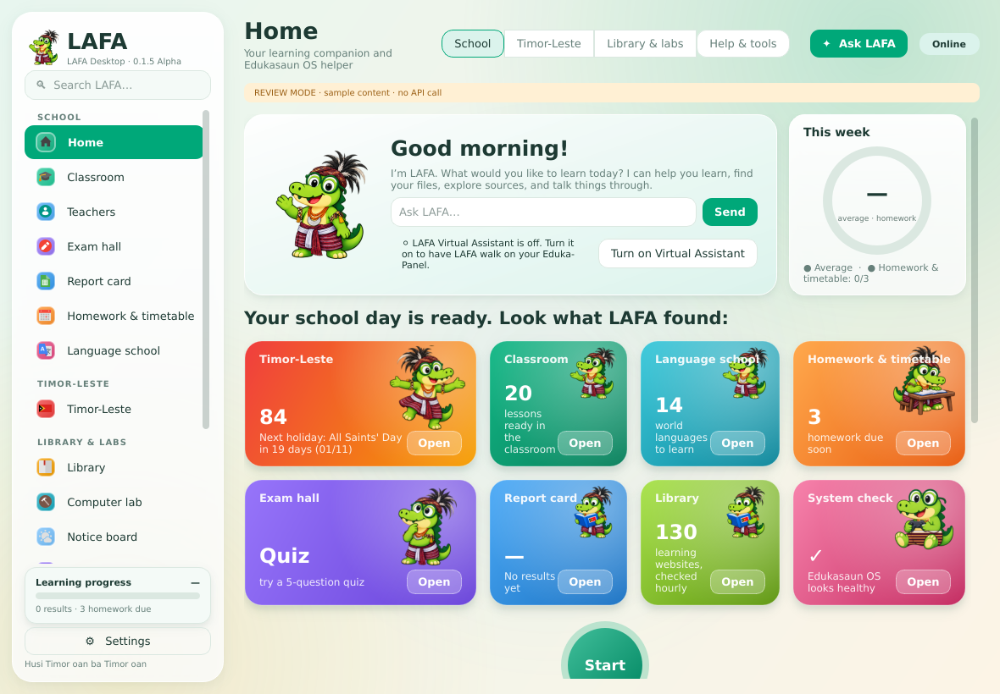
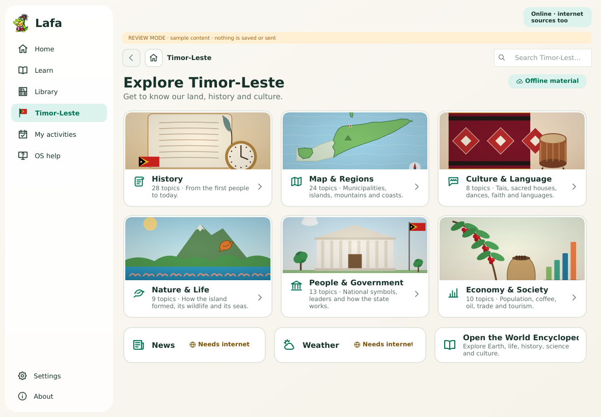
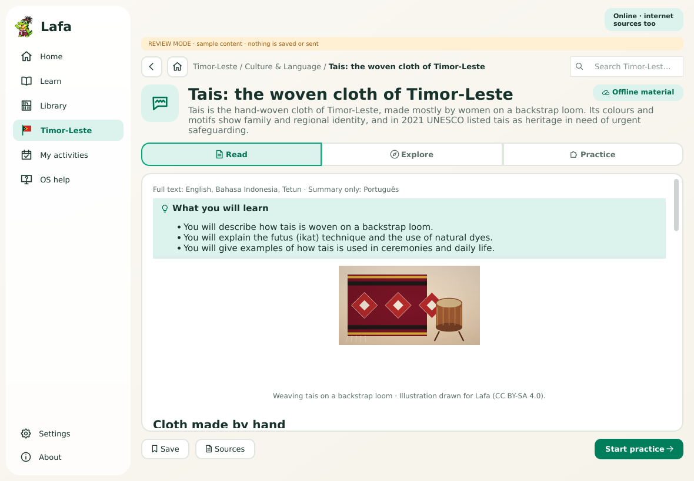
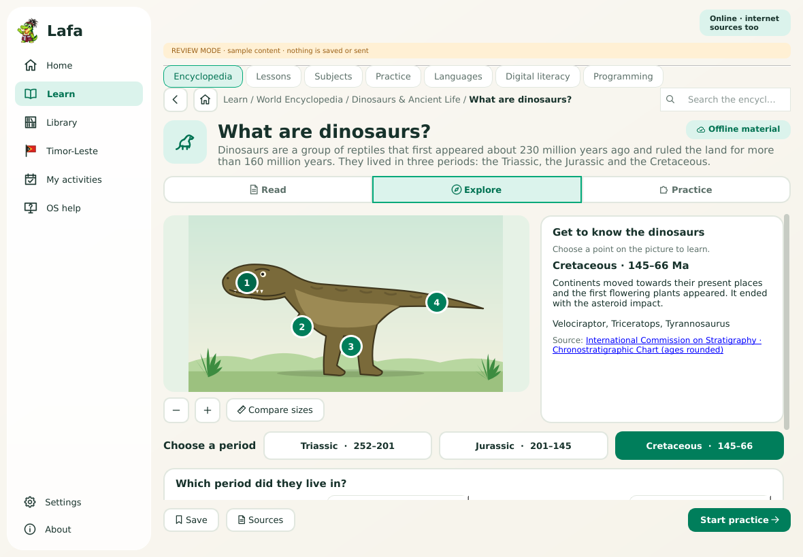
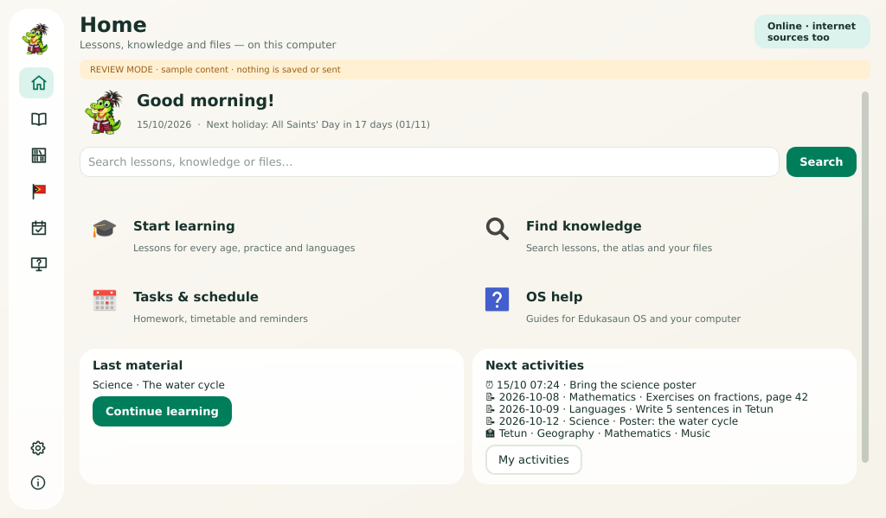
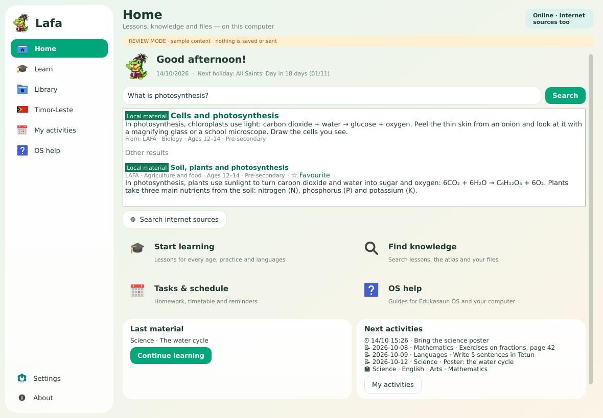
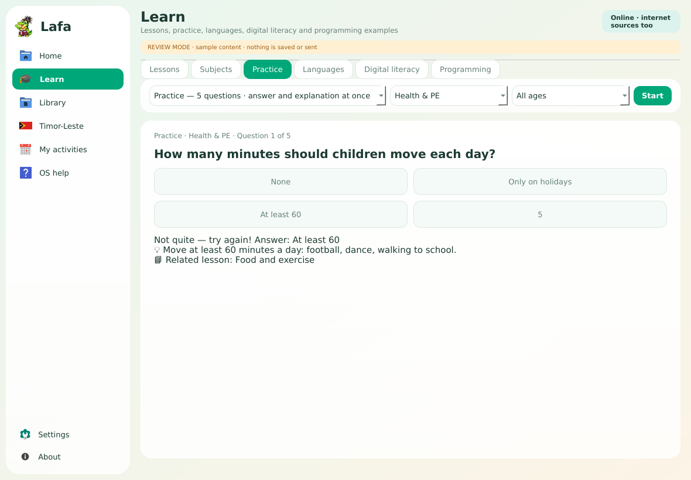
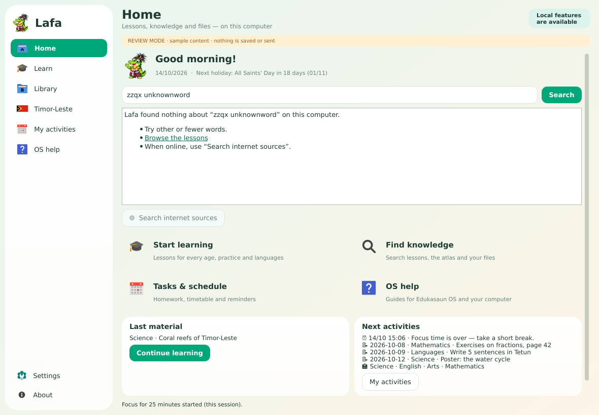

# Lafa — Pendamping Belajar dan Asisten Edukasaun OS

**Lafa 0.2.1 Alpha** is a learning companion and Edukasaun OS assistant from
Timor-Leste, for **Edukasaun OS** (Debian 13 Trixie, LXQt) and the
**Eduka-Desktop Suite** (Eduka-Desktop, Eduka-Panel, Eduka-Settings).

Its main functions work **without login, without an AI key, without a Lafa
server and without internet**. The internet only *adds* learning sources
(Wikipedia, learning websites, Timor-Leste news, weather).

Lafa is **not** a generative AI and cannot answer every question. It searches
the lessons, guides and files on this computer, shows where each result comes
from, and says honestly when it found nothing.

The interface follows the system language: Tetun, Português, Bahasa Indonesia,
with English as the fallback. See the [CHANGELOG](CHANGELOG.md), [offline
behaviour](docs/OFFLINE.md) and [how to keep developing Lafa](docs/DEVELOPMENT.md).

















[View all captures](docs/SCREENSHOTS.md). Captures of Lafa on the desktop
show actual Lafa pixels on an **illustrated desktop**, not Edukasaun OS.

## Install on Edukasaun OS

```bash
sh tools/build-deb.sh                       # -> dist/lafa_0.2.1_all.deb
sudo apt install ./dist/lafa_0.2.1_all.deb  # dependencies come from Debian
```

`apt` installs the dependencies (`python3-pyqt5`, the same Qt binding as the
Eduka-Desktop suite, `libqt5svg5`, `fonts-noto-color-emoji`, …).

Recommended packages add:
- read aloud (`espeak-ng`) and PDF reading (`poppler-utils`);
- Papirus icons and fullscreen detection (`x11-utils`);
- the desktop tools that OS help can open.

Suggested: `kiwix` (Wikipedia and books offline), `orca`, `onboard`.

Updates come through APT / the Eduka Update Service. Lafa is not a second
updater and never runs downloaded code. Upgrading from 0.1.x keeps tasks,
timetable, practice results, reminders, files and preferences (see
[Upgrading](#upgrading-from-01x)).

## Six sections

The sidebar has six sections. **Settings** and **About** sit at the bottom.
Keyboard: `Alt+1` … `Alt+6` open the sections and `Ctrl+F` focuses search.
Below 1100 px the sidebar becomes a compact icon bar.

| Section | What is in it |
|---|---|
| **Beranda / Home** | Search box, four quick accesses (Mulai Belajar, Cari Pengetahuan, Tugas & Jadwal, Bantuan OS), last material with *Continue learning*, the next activities |
| **Belajar / Learn** | **World Encyclopedia** (12 categories, sourced articles with objectives, figure, activity, questions; interactive Dinosaurs, Earth-history and Industrial-Revolution modules; coverage list), lessons for ages 5–100 and the Timor-Leste school subjects; subject guides; **Latihan** and **Simulasi Tes** with explanations and *retry my mistakes*; first phrases in many languages; digital literacy; programming examples |
| **Perpustakaan / Library** | **Download all sources for offline use** (one button), my files, saved material, internet sources (with metadata and an on-demand status check), Wikipedia, favourites, external sites (reference works, Kiwix, optional AI websites, community wikis) |
| **Timor-Leste** | An encyclopedia in six illustrated categories (History · Map & Regions · Culture & Language · Nature & Life · People & Government · Economy & Society) → topics → articles, with Back, Home, breadcrumb and search; News and Weather (need internet) |
| **Aktivitas Saya / My activities** | Tasks and timetable, reminders and focus, **Hasil Latihan** (practice results) |
| **Bantuan OS / OS help** | Edukasaun OS guides, accessibility, computer check, open the tools that are installed |

## Search: local first

The search box says *"Cari pelajaran, pengetahuan, atau file…"*. It is a
search, not a chatbot. Every result carries a label:

- **Materi lokal** (lesson or atlas text shipped with Lafa);
- **File lokal** (a file name in the folders you chose);
- **Materi tersimpan** (an article or page you saved);
- **Sumber internet** (only after you press *Cari sumber di internet*).

How it answers:

- **"Apa itu fotosintesis?"** → the lesson text with its reference. If that
  is not enough, the separate *Cari sumber di internet* button searches
  Wikipedia. Nothing is sent automatically.
- **"Cari file tugas matematika"** → a file-name search in your chosen folders.
- **"Bagaimana mengganti wallpaper?"** → the local Edukasaun OS guide.
- A weak match is shown as a list of material to choose from, not as an answer.
- **Nothing found** → Lafa says so and suggests other words, the lesson list,
  or the internet button. It never makes up an answer.

Article extracts are labelled *Kutipan artikel* with publisher, address and
fetch date. They are kept apart from Lafa's own lesson text.

## Offline and online

| Works offline (always) | Adds something when online |
|---|---|
| Search of lessons, atlas, guides, saved material and file names; lessons for ages 5–100; practice and test simulations with explanations; practice results; languages; digital literacy; programming examples (bounded Python); Timor-Leste atlas; tasks, timetable, reminders (they ring offline) and focus; OS help; calculator; read aloud; the Virtual Assistant | Wikipedia extracts, learning-website status, Timor-Leste and world news, weather, saving an article for later, refreshing saved sources |

Offline, Lafa shows a calm *"Fitur lokal tetap tersedia"* badge. There are
no repeated connection pop-ups. Each internet service fails on its own and
never removes local results or freezes the window. Details:
[docs/OFFLINE.md](docs/OFFLINE.md).

## Practice and results

- **Latihan** (5 questions, answer and explanation at once).
- **Simulasi Tes** (10 questions, results at the end).
- **Simulasi Tes berwaktu** (20 questions, 20 minutes).

A session never repeats a question. When a subject has fewer questions than
asked, Lafa uses fewer and says so. Wrong answers show the lesson sentence
that explains the answer and the related lesson, when a lesson states it.
Lafa does not invent explanations. *Retry my mistakes* repeats only the wrong
questions.

**Hasil Latihan** shows personal progress on this computer: attempts,
*average score*, best score. It is **not an official school report card**,
and an average score is not a completion percentage.

Lessons carry an ID, topic, difficulty, languages, source, review date,
version and licence (CC BY-SA 4.0). They are **not yet reviewed by the
Ministry of Education**. Lafa does not claim national-curriculum alignment.
The lesson files (`lafa/assets/curriculum/*.json`) are checked by
`tools/check-curriculum.py`.

## Internet sources

The Library lists curated learning websites and Timor-Leste media, including
the **Governo de Timor-Leste** (https://timor-leste.gov.tl/) and the
**Ministério da Educação** (https://moe.gov.tl/). Each source shows its
languages, topics, level, access (free, free with account, partly paid, paid)
and why it was chosen. Not all sources are free or of equal quality.

The status check runs on demand, is cached for a day, and has a *Check now*
button. Its results are **ok**, **not found**, **restricted** or **unknown**.
A reachable website is not proof that its content is correct.

Fandom, Everything2 and Conservapedia are not academic sources. They appear
only under *community & entertainment wikis*, with a note.

News and extracts show title, publisher, address and the publication or fetch
date. Cached data is labelled as cached, never as "latest". Lafa reads only
front pages and feeds (robots.txt respected), never whole sites, and never
logs in or scrapes behind a login.

**Kiwix** works offline once installed: `sudo apt install kiwix`, then copy a
ZIM archive. Lafa never downloads large archives by itself.

## Optional AI websites

*Perpustakaan → Situs eksternal* has three links (ChatGPT, Claude, Gemini),
labelled **"Buka di browser"**. They open in your own browser, where you sign
in yourself.

Lafa does not:
- build an AI login;
- read accounts, cookies, passwords or browser sessions;
- send questions or documents anywhere by itself;
- install Ollama or download AI models.

## Lafa Virtual Assistant

The calm crocodile on the Eduka-Panel is switched on only in **Eduka-Settings
→ Lafa-Configuration**. Opening Lafa Desktop does not switch it on.

- **Click it** for the popup: search "Find material or files…", four tiles
  (Continue learning · Explore · Tasks · OS help), one recommendation, and
  Open Desktop · Read aloud (only with a local voice) · Quiet mode. No microphone.
- **Quiet mode** stops spontaneous messages, hover questions and self-talk.
- Spontaneous messages are **limited per hour** (default 4). They pause while
  you type, while Lafa is paused, and while another app is fullscreen (X11).
- **Reduce motion** stops walking and dance animations.
- **Entertainment** (magician, mind reader, comedian, bathing/toilet and party
  animations, jokes) is off by default and switched on in Settings.
- Greetings, positive messages and Timor-Leste identity stay. There are three
  outfits: Tais Mane, Formal, Casual Belajar. Walking uses 8 drawn frames
  synced to the distance moved; transparent corners pass clicks through.
- On X11 Lafa walks along the available panel. On **Wayland** (tested with
  Weston 13, headless) Lafa does not roam: it walks in place, the click mask
  and the popup work, and the compositor decides the window position;
  fullscreen pause is X11-only.

## Upgrading from 0.1.x

- Settings, tasks, timetable, practice results, reminders, saved material and
  chosen folders are kept.
- Old AI fields (provider, models, server addresses) are ignored. The old
  settings file is backed up once to `~/.config/lafa/settings.json.0.1-backup`
  (mode 0600).
- Lafa does not touch the system keyring. If a key was stored there by 0.1.x,
  it stays until you remove it yourself (for example with Seahorse).
- The old AI code (providers, AI Hub, sign-in, transcription) remains
  available in Git history.

## Run from source (developers)

See [docs/DEVELOPMENT.md](docs/DEVELOPMENT.md). In short:

```bash
sudo apt install python3-pyqt5 libqt5svg5 papirus-icon-theme fonts-noto-color-emoji
LAFA_QT=pyqt5 python3 -m lafa.app --review     # Edukasaun OS stack (PyQt5)
python3 -m venv .venv && .venv/bin/pip install -e . && LAFA_QT=pyside6 .venv/bin/lafa --review   # PySide6
QT_QPA_PLATFORM=offscreen python3 -m pytest -q   # tests (PyQt5 and PySide6)
```

## Commands in the search box

```text
/help              what Lafa can do
/os  /os wifi      Edukasaun OS guides
/calc (3+4)*2      calculator (no eval)
/remind 5 Drink water
/joke              only with entertainment switched on
/ask photosynthesis   Wikipedia extract (internet, only when you ask)
/weather Dili  /news  /timor education   (internet)
```

Ordinary requests also work in the four languages, for example "buka
kalkulator", "loke kelas", or "ingatkan saya 10 menit lagi minum air". They
use a fixed, safe list of apps and pages. Lafa never runs a shell command.

## Limits

- Lafa is a search and learning tool. It does not generate text and cannot
  answer everything.
- Lessons are not reviewed by the Ministry of Education. Short language
  courses are first phrases, not full courses. The glossary is curated; Lafa
  does not translate freely.
- On Wayland Lafa cannot place or move its own window (protocol limit); it
  stays where the compositor puts it. Fullscreen detection needs `xprop`
  (x11-utils) on X11.
- The encyclopedia is not complete: 34 hand-written articles plus the
  regrouped atlas topics; the coverage list shows what is planned. Facts,
  links and Tetun terms awaiting a human check are in
  [docs/CONTENT-REVIEW.md](docs/CONTENT-REVIEW.md).
- Online features (Wikipedia, news, weather, source checks) were tested with
  recorded data; real websites can change.
- [Validation](docs/VALIDATION.md) · [Security](docs/SECURITY.md) ·
  [Privacy](docs/PRIVACY.md) · [Architecture](docs/ARCHITECTURE.md) ·
  [Eduka integration](docs/EDUKA-INTEGRATION.md) · [Assets](docs/ASSETS.md)

Code license: MIT. Lesson content: CC BY-SA 4.0. The supplied character
identity remains subject to its owner's rights.
