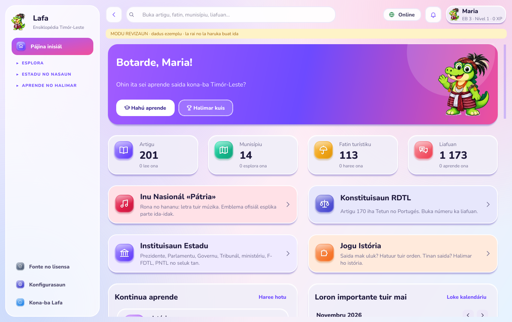
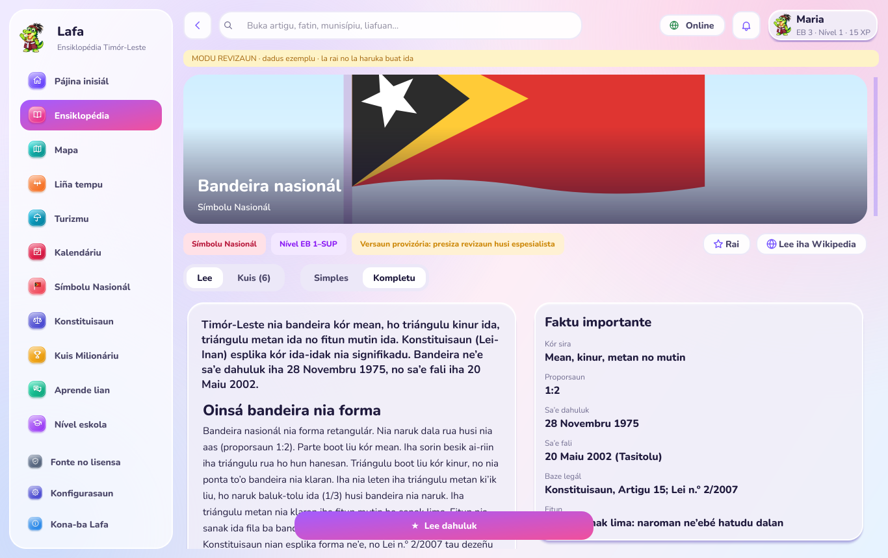
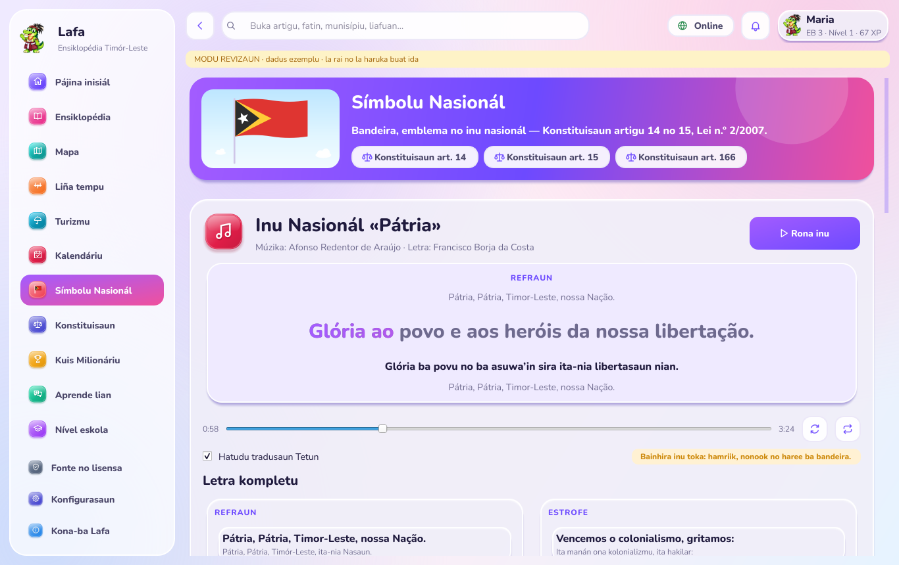
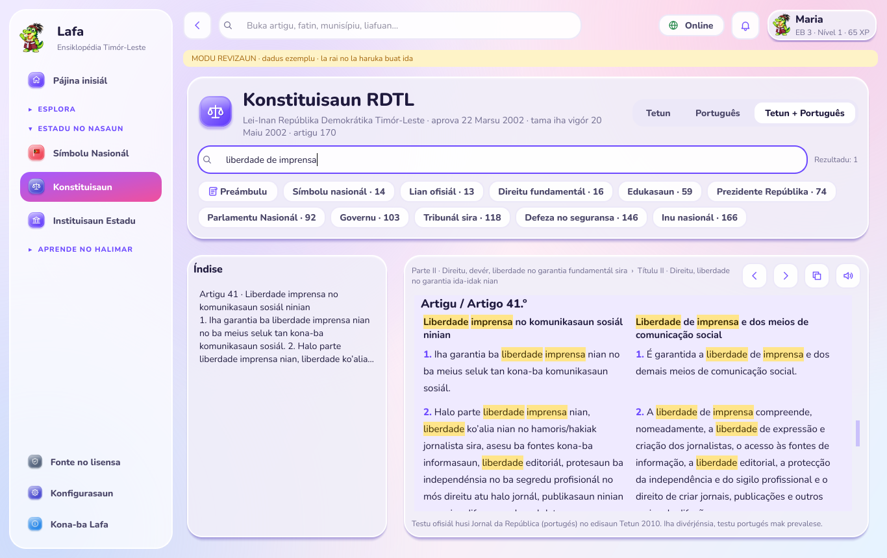
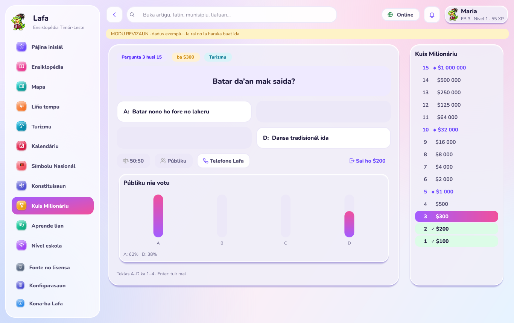
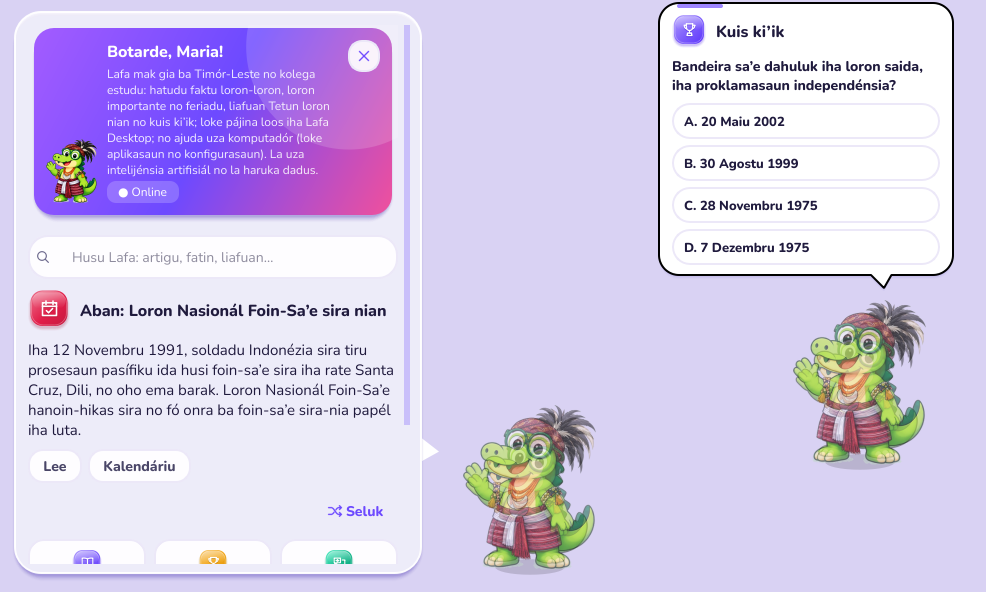

# Lafa — Ensiklopédia Timór-Leste

**Lafa 0.3.1 Alpha** is free software for **Edukasaun OS** (Debian 13 Trixie,
LXQt, the Eduka-Desktop suite). It has two parts:

* **Lafa Desktop** — an interactive **encyclopedia of Timor-Leste**, from the
  formation of the island and its fossils to 2026, for students of every
  school level and for visitors. The interface and the texts are in **Tetun,
  Português, English and Bahasa Indonesia** — the official languages
  (Constitution, art. 13) and the working languages (art. 159).
* **Lafa Virtual Assistant** — Lafa the crocodile on the Eduka-Panel: a
  **Timor-Leste guide, study buddy and computer helper** (switched on in
  Eduka-Settings → Lafa-Configuration).

Everything works **offline**. With internet, Lafa downloads texts and
free-licence photos for offline use and updates its data. No login, no AI,
no Lafa server, no personal data sent.













[All screenshots](docs/SCREENSHOTS.md) are captures of the real application
(review mode, sample learner "Maria"). The character sheet in `docs/design/`
is the owner's concept art.

## What is inside Lafa Desktop

| Menu | What you find |
| --- | --- |
| **Pájina inisiál** (home) | Greeting, totals, continue learning, next holidays (calendar), this day in history, Tetun word of the day, "did you know?", population chart (World Bank), content and progress charts, place of the week, achievements |
| **Ensiklopédia** | 18 illustrated categories: land, geology and climate · nature and animals · **prehistory** (fossils of the ancient seas, the 2026 pterosaur of Lesululi, Stegodon, the first people 44 000 years ago, rock art) · history · colonialism and occupation · conflicts and reconciliation · State and politics · **State institutions** (ministries, F-FDTL, PNTL, independent bodies) · presidents and prime ministers · national symbols · map, municipalities and islands · culture and tradition · **sports** (football, Olympic and SEA Games, martial arts, Tour de Timor, Dili Marathon…) · society · economy · tourism · holidays · Timor-Leste in the world. Every article: simple or complete text, key facts, timeline, related pages, a quiz, sources with licences, a photo gallery, read aloud |
| **Mapa** | Interactive map of the 14 municipalities (Ataúro since 2022, Oe-Kusi Ambenu RAEOA), administrative posts, tourist places; zoom, search, details |
| **Liña tempu** | More than 750 dated events from the fossils of Timor (millions of years ago) and the first people 44 000 years ago to 2026, by era and topic, with search |
| **Símbolu Nasionál** | The national anthem «Pátria» (instrumental) with **every line lighting up as it is played** — the official Portuguese words with the Government's Tetun and English translations (Indonesian by Lafa) — the flag with the colours of art. 15, and the **official emblem** with its 13 parts explained (click a number), the motto «Unidade, Acção, Progresso» |
| **Konstituisaun** | The **Constitution of the RDTL** in Tetun, Portuguese or both side by side: contents, quick links, **search by article number or words**, copy and read aloud |
| **Instituisaun Estadu** | The State institutions, starting with the four organs of sovereignty (President of the Republic, National Parliament, Government, courts — Constitution art. 67), then the Government's ministries, justice (Court of Appeal, Public Prosecution), F-FDTL and PNTL, independent bodies (PDHJ, CNE, CAC, Civil Service Commission) and agencies |
| **Turizmu** | Beaches, mountains, museums, memorials, churches, reefs and more in every municipality, with filters, pictures, tips and the map |
| **Kalendáriu** | Public holidays and national days for any year (Easter and Islamic dates computed), next holiday, export to `.ics` |
| **Kuis Milionáriu** | "Who wants to be a millionaire?" about Timor-Leste: 15 questions from easy to hard, prizes in US dollars (just for fun), safe havens at 5 and 10, lifelines 50:50, audience and "phone Lafa", optional clock |
| **Jogu Istória** | History game: which came first?, put four events in order, which year? — easy, medium and hard, ten rounds, a review of the events with links to the articles |
| **Aprende lian** | 1 173 Tetun words in 30 topics, **both ways**: learn Tetun from your language (with a guide to reading Tetun) or learn Portuguese, Indonesian, English and the ASEAN and CPLP languages (Malay, Filipino, Thai, Vietnamese, Khmer, Lao, Burmese, Chinese, Tamil, Spanish, French) from Tetun. Thai, Khmer, Lao, Burmese, Chinese and Tamil words show **how to read them in Latin letters**; word list, flash cards with spaced repetition, quiz |
| **Nível eskola** | Learning paths for the levels of the Ministry of Education: Ensinu Báziku cycles 1–3, Ensinu Sekundáriu, Ensinu Superiór/adults; units with a unit quiz |
| **Fonte no lisensa** | The owner's main sources, every source used (more than 1 300) with licence and the articles that use it, licences of Lafa, credits, downloaded photos with their authors |
| **Offline no atualizasaun** | Download the offline pack, check for new content, refresh World Bank data, storage used |

Search (Ctrl+F) looks through every article, municipality, place, holiday,
article of the Constitution and word, in all four languages (accents and
apostrophes do not matter).

## Lafa Virtual Assistant — what it is for

Recommendation, implemented in 0.3.0: Lafa is a **Timor-Leste guide + study
buddy + computer helper** that is useful without being noisy.

* **Shares knowledge often** (every 10 minutes by default, at most 6 times an
  hour, never in quiet mode or over a full-screen app): holidays coming up,
  this day in history, facts, a Tetun word, **a mini quiz you answer in the
  balloon**, a place to visit, words to review, the next article for your
  school level, encouragement for your learning streak, an article of the
  Constitution, the national anthem to sing along.
* **Answers questions offline**: type in the popup to search the encyclopedia
  and the words; a result opens Lafa Desktop on the right page.
* **Quick tiles**: continue reading, millionaire quiz, words, map, calendar,
  **PC help** (opens safe applications from a fixed list: files, browser,
  settings, Wi-Fi, sound, printer, screenshot, LibreOffice…).
* **Better clothes and design**: the three outfits from the owner's character
  sheet — *Casual Belajar*, *Tais Mane* and *Formal* — with waving poses cut
  from the design (tools/make-poses.py); pastel popup matching Lafa Desktop.
* **Smoother animation**: 60 frames a second with cached pictures, real-time
  timing (falls back to 30 fps on slow computers), smooth walking with easing.

## Install on Edukasaun OS

```bash
sh tools/build-deb.sh                       # -> dist/lafa_0.3.1_all.deb
sudo apt install ./dist/lafa_0.3.1_all.deb  # dependencies come from Debian
lafa                                        # or the "Lafa Desktop" menu entry
```

Depends: `python3-pyqt5`, `python3-pyqt5.qtsvg`, `libqt5svg5`, `xdg-utils`.
Recommends: `python3-pyqt5.qtmultimedia`, `libqt5multimedia5-plugins` and `gstreamer1.0-plugins-good` (the
anthem; `mpg123` or `ffmpeg` also work), `espeak-ng` (read aloud), `fonts-noto-core` and `fonts-noto-cjk`
(Thai, Khmer, Lao, Burmese, Tamil and Chinese words), the desktop tools that
PC help can open. Developers can run from the source tree with
`python3 -m lafa.app` (PyQt5) or `LAFA_QT=pyside6 python3 -m lafa.app`.

## Offline and online

* The whole encyclopedia, map, quiz, words and learning paths are in the
  package (`lafa/assets/timor`).
* **Offline pack** (Offline no atualizasaun → Download hotu): the Wikipedia
  introduction of each item in Tetun, Portuguese, English and Indonesian (CC BY-SA 4.0), one photo
  per item and, if chosen, a **gallery of 3 more photos** from Wikimedia
  Commons — **only free licences** (CC0, public domain, CC BY, CC BY-SA),
  saved with author and licence (SQLite in `~/.local/share/lafa`).
* **New content**: Lafa reads `manifest.json` from this public repository and
  downloads changed files only after checking SHA-256, size and JSON shape.
  Data only — never code.
* **World Bank** indicators (CC BY 4.0) can be refreshed.

See [docs/OFFLINE.md](docs/OFFLINE.md) and [docs/PRIVACY.md](docs/PRIVACY.md).

## Sources, Tetun and review

* Sources named by the owner come first: wikipedia.org, tet.wikipedia.org,
  timor-leste.gov.tl, timorleste.tl, timorleste.mafint.org, timor-research.org,
  data.worldbank.org, britannica.com, tripadvisor.com and moe.gov.tl, plus the
  UN, the Chega! report, the Central Bank, La'o Hamutuk, Tatoli and others.
  Texts are Lafa's own wording; every item lists its sources with licence and
  date accessed.
* **Tetun follows the official text of the Constitution** (Lei-Inan,
  Prezidente Repúblika, Parlamentu Nasionál, tasi-le'un…): see
  [docs/TETUN-STYLE.md](docs/TETUN-STYLE.md).
* All content is marked **draft** until experts review it; each item has
  review notes. See [docs/CONTENT-REVIEW.md](docs/CONTENT-REVIEW.md).

## Licences

* Code: **MIT** (© 2026 Hugo Moniz do Rego).
* Constitution: official texts (Jornal da República; Tetun edition 2010).
  Anthem «Pátria»: music Afonso Redentor de Araújo, lyrics Francisco Borja da
  Costa; recording provided by the project owner (licence to be confirmed,
  see docs/ASSETS.md).
* Encyclopedia texts, quizzes, vocabulary and illustrations: **CC BY-SA 4.0**.
* Map: geoBoundaries — OCHA ROAP / WHO (**CC BY 3.0 IGO**); municipalities are the union of their administrative posts.
* World Bank data: **CC BY 4.0**. Font Nunito: **SIL OFL 1.1**.
* Downloaded photos keep their own free licence and author (shown in the app).

Details: [docs/ASSETS.md](docs/ASSETS.md) and the in-app page *Fonte no lisensa*.

## Development

```bash
python3 tools/check-content.py           # validate all content (add --strict for warnings)
python3 tools/make-manifest.py           # update the content manifest (release)
LAFA_QT=pyqt5 QT_QPA_PLATFORM=offscreen python3 -m pytest -q
LAFA_QT=pyside6 QT_QPA_PLATFORM=offscreen python3 -m pytest -q
python3 scripts/capture-screenshots.py   # docs/screenshots
sh tools/build-deb.sh                    # dist/lafa_<version>_all.deb
```

More in [docs/DEVELOPMENT.md](docs/DEVELOPMENT.md), [docs/CONTENT-SCHEMA.md](docs/CONTENT-SCHEMA.md)
and [docs/ARCHITECTURE.md](docs/ARCHITECTURE.md).

## Upgrading

From 0.3.0: everything is kept. The interface has four languages again, so a
setting of English or Indonesian is used as it is; "follow the system" now
gives Portuguese, English or Indonesian to systems in those languages and
Tetun to all others.

From 0.2.x: settings, progress, favourites and quiz results are kept; old
start pages move to the nearest new page. The old school, library, world
encyclopedia, news, weather and AI links were removed: Lafa Desktop is only
about Timor-Leste.

## Ideas for next versions

Expert review of all drafts with teachers (start with history and the State);
audio pronunciation of Tetun words recorded by native speakers; more places
with photos taken in Timor-Leste under a free licence; Mambai, Makasae and
other national languages in the word list; printable worksheets per school
level; a classroom mode for teachers (quiz on a projector); Kiwix-style full
Wikipedia offline packs.
