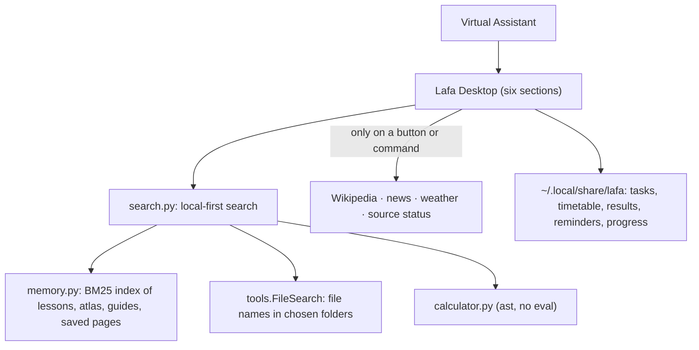
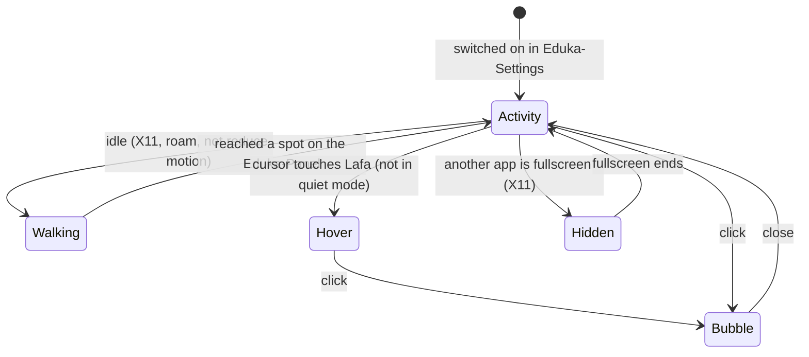

# Architecture

Lafa is a Python/Qt desktop client: PyQt5 on Edukasaun OS, with PySide6 for
developers through `lafa/qt.py`. One process shows three surfaces: Lafa
Desktop, its settings window and the Virtual Assistant. There is no Lafa
server, no AI service, no embedded browser and no background daemon.

## Offline first

Local features never check the connection. These are search, lessons,
practice, files, reminders, focus, OS help, the calculator and read aloud.

`net.online_probe` only decides whether the internet buttons (Wikipedia,
news, weather, source status, saving a page) are enabled. Each internet job
runs in a worker (`Job` / `Delivery`) with its own timeout and error handler.
A failure changes only that button's note and never the local results. See
[OFFLINE.md](OFFLINE.md).

## Six sections

`app.PAGES` lists the six sections: home, study, library, timor, activities
and oshelp. `app.TABS` lists each section's tabs. `app.ROUTES` maps every
0.1.x page name (`classroom`, `exams`, `report`, `homework`, `learn`, `hub`,
`live`, `culture`, `os_help`, …) to a (section, tab). Old start-page
preferences, actions such as "buka kelas", and IPC roles keep working.
`navigate(page, tab)` accepts section keys, old keys and indexes.

Each tab page is wrapped by `fit_small_screen()`: long drop-down lists shrink,
and pages scroll instead of being cut off at 1024×600 or with large text.
Below 1100 px the sidebar becomes an icon bar. Shortcuts (`Alt+1…6`,
`Ctrl+F`) belong to the rebuilt widgets, so rebuilding never duplicates them.

## Modules

| Module | Responsibility |
|---|---|
| app | Window, six sections and their tabs, Home, search panel, results HTML (`lafa://` links), reminders and focus, settings window, About, worker delivery, tray |
| search | Understands a request (files / calc / OS guide / topic), runs the local search, labels results (lesson, guide, file, saved, internet), decides answer vs. choices vs. none; never uses the network |
| agent | Direct commands (`/help`, `/os`, `/calc`, `/remind`, `/joke`, `/ask`, `/weather`, `/news`, `/timor`); internet commands are refused offline with a calm message; no AI |
| memory | BM25 search engine with accent folding and cross-language synonyms over built-in lessons, atlas and guides, plus public pages saved on request (front page and feed only, robots.txt, HTTPS, same-site redirects); cache `~/.cache/lafa/memory` (0600) |
| reminders | Dated reminders saved atomically (0600); fire once, offline too; missed ones shown once after restart; session-only focus items |
| progress | Last opened material, recent list, favourites and quiz/activity scores (`progress.json`, 0600) |
| classroom | School lessons, unique question generation with lesson-based explanations, Latihan / Simulasi Tes sessions, retry of mistakes, personal results |
| curriculum | Lessons for ages 5–100 (18 subjects × 7 levels) from `lafa/assets/curriculum/*.json` with ID, topic, difficulty, licence and review metadata |
| school | Subject guides, offline practice (maths, vocabulary, quizzes), tasks and timetable |
| sources / source_meta | Learning websites, Timor-Leste media and official sources (timor-leste.gov.tl, moe.gov.tl); metadata (languages, topics, level, access, reason, academic); status ok / not found / restricted / unknown, on demand, cached 24 h; community wikis kept separate |
| tools | Bounded file-name search, secure document reading, Wikipedia search and extracts, curated reference links |
| live_info / timor | Weather (Open-Meteo), world and Timor-Leste RSS headlines with publisher and dates |
| livefacts | Optional refresh of atlas topics from Wikipedia, dated cache |
| timorleste / timor_atlas | Timor-Leste history, symbols, municipalities, leaders, holidays |
| osguide | Edukasaun OS guides in four languages, fixed tool allowlist (no shell), read-only computer check |
| actions | Requests in four languages → fixed list of apps and Lafa pages, reminders, search |
| encyclopedia | Encyclopedia data: 12 world and 6 Timor-Leste categories, articles from `lafa/assets/encyclopedia/**.json` plus the atlas topics adapted as `atlas:<key>`, objectives, generated questions for atlas topics, related links, coverage, accent-folded search |
| encyclopedia_ui | `Browser` per area (home → category → article, search, coverage, News/Weather) with a history stack that restores page, tab and scroll; `ArticlePage` (one reader, Read / Explore / Practice, contents panel ≥ 1150 px), `QuizWidget` |
| interactive | Dinosaurs (hotspots, periods, size chart, exercise), Earth-history timeline (geological and human scales kept apart), Inventions & Industrial Revolution (order, match, impacts); scores saved with `progress.record` |
| widgets / icons | Shared components (cards, tiles, rows, badges, empty state, NavBar) and packaged SVG icons and illustrations (QtSvg, image-plugin fallback) |
| offline_pack | The *Download all sources* button: source front pages, Wikipedia intros per article and language, free-licence Commons pictures; bounded, stoppable, stored in `~/.local/share/lafa/offline` (0600) |
| mascot / motion / outfits / personality / roles | Virtual Assistant: quick actions, quiet mode, hourly message limit, fullscreen pause (X11), reduce motion, optional entertainment, outfits and movement |
| eduka | Eduka-Desktop compatibility: language, panel geometry, theme, notifications, agenda, fullscreen check, Lafa-Configuration launcher |
| config | Settings with bounds; ignores and backs up 0.1.x AI fields; `AI_LINKS`, `SECTIONS`, `LEGACY_PAGES` |
| net | HTTPS-only requests with size limits and redirect refusal; connection probe on public hosts |
| updates | Validated content catalogue (data only); no program updates |
| learning | Bounded AST teaching interpreter (no eval, exec, imports, files or network) |
| calculator | Arithmetic parsed with `ast`, never `eval` |
| voice | Local espeak-ng read aloud |
| i18n / i18n_v2 | English, Bahasa Indonesia, Português, Tetun; i18n_v2 overrides the 0.2.0 wording |
| ui_kit | Palette from the Eduka accent (light and dark), cards, chips |
| pdf_worker | Resource-limited Poppler conversion |
| instance / desktop_entry | Single instance with fixed same-user roles; launcher quoting |
| integration/eduka_lafa_settings | Lafa-Configuration page for Eduka-Settings (keeps the host's Qt binding, atomic save, `--reload`) |

## Limits

- File search stops at 40,000 entries, depth 10, eight seconds or 120 matches.
- Documents stop at 10 MB and 20,000 preview characters; PDFs at 30 pages.
- Lesson code stops at 20,000 characters, 1,200 AST nodes and 10,000 steps.
- Internet requests use timeouts and size limits and accept only HTTPS.

## Virtual Assistant behaviour

Spontaneous messages need all of these: not quiet mode, no fullscreen app, not
paused, no typing, idle for a minute, and under the hourly limit. The bubble's
quick actions (continue, tasks, focus, OS help) work offline. Entertainment
activities are excluded unless switched on. On Wayland the compositor owns the
window position, and this has not been tested.
