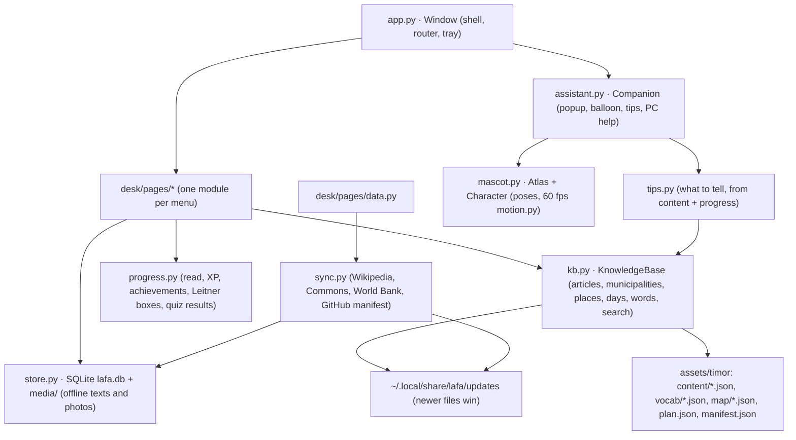

# Architecture (Lafa 0.3)

Lafa is a Python/Qt desktop application: PyQt5 on Edukasaun OS, PySide6 for
developers (`lafa/qt.py` is the only place that imports a binding). One
process shows Lafa Desktop and, when it is switched on, the Virtual
Assistant. There is no Lafa server, no AI service and no embedded browser.

## Modules

| Module | Role |
| --- | --- |
| `app.py` | `Window`: sidebar (9 menus + sources, settings, about), top bar (back, search, online chip, notifications, profile), page stack with fade, history, toasts, tray, single instance, Eduka-Settings roles (`--virtual-enable`, `--configure`, …) |
| `desk/theme.py` | Colour tokens (light/dark), Nunito fonts, pastel background, clay icons, the application style sheet |
| `desk/widgets.py` | Glass `Card`, `Clickable`, `ClayIcon`, `Pill`, `Segmented`, `ListRow`, `CourseCard`, `Banner`, charts (`Donut`, `AreaChart`, `BarChart`), `CalendarCard`, `ResponsiveGrid`, `FlowLayout`, `Toast` |
| `desk/texts.py` | Interface words in four languages (`t(lang, key)`); pages add their own with `extend()` |
| `desk/pages/*` | `home`, `encyclopedia` (+ category), `article` (every item kind + `QuizWidget`), `mapview`, `timeline`, `places`, `calendar` (+ `.ics`), `millionaire` (`Game` logic is UI-free), `language`, `paths`, `sources`, `data`, `settings`, `about`, `search` |
| `kb.py` | Loads all content (packaged + updates), BM25 search in four languages with title boost and type-ahead, holidays for any year (Easter, Islamic table), timeline and eras, questions by difficulty, learning paths per school level, sources index |
| `progress.py` | Personal progress (0600 JSON): read items, favourites, quiz results, Leitner boxes for words, millionaire results, XP, achievements, streak |
| `store.py` | SQLite database for downloaded Wikipedia introductions and photos (with author/licence) |
| `sync.py` | Network jobs (HTTPS only, fixed hosts, no redirects, size limits): offline pack, World Bank series, content updates with SHA-256 |
| `assistant.py` | The Virtual Assistant window: Lafa on the panel, popup, tip balloon with mini quiz, walking, quiet mode and hourly limit |
| `tips.py` | Chooses the next tip (holiday first on the eve and the day itself, then a rotation) |
| `mascot.py` / `motion.py` / `outfits.py` | Character drawings, cached scaling, waving poses, procedural movement, activity scenes |
| `config.py` | Settings (XDG, 0600), migration from 0.1/0.2 |
| `eduka.py` | Reads Eduka-Desktop preferences (language, theme, panel), opens Lafa-Configuration |

## Content

Content is data, never code: JSON described in
[CONTENT-SCHEMA.md](CONTENT-SCHEMA.md) and validated by
`tools/check-content.py`. `plan.json` lists the planned ids and the
categories; `manifest.json` (made by `tools/make-manifest.py`) lists every
file with its SHA-256 for the update channel.

## Threads

Network work runs in `QThreadPool` workers (`Job` in `app.py`, `Task` with
progress and cancel in `desk/pages/data.py`); results come back through Qt
signals. The interface never waits for the network.
